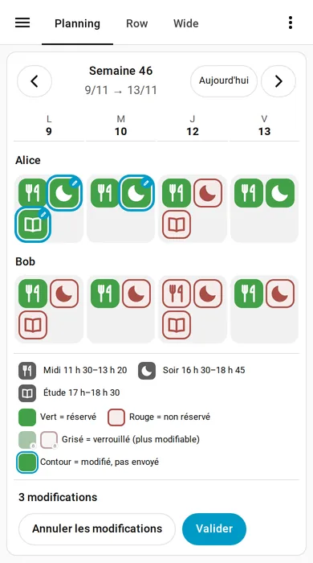
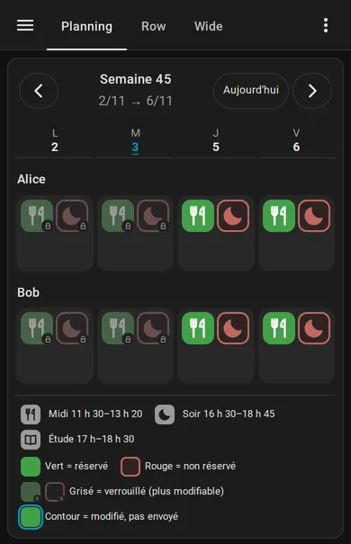
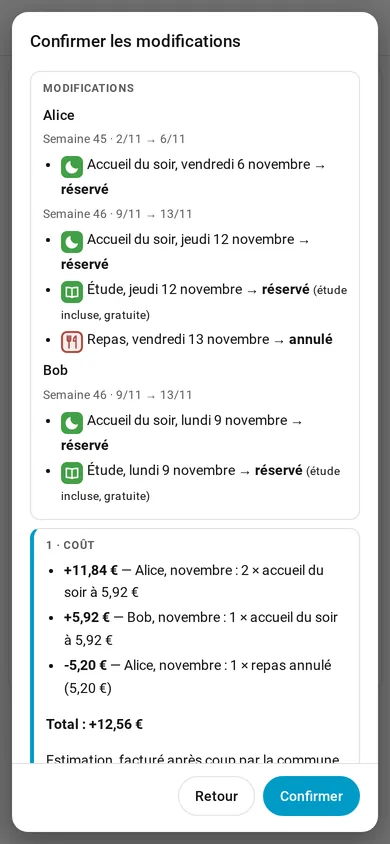
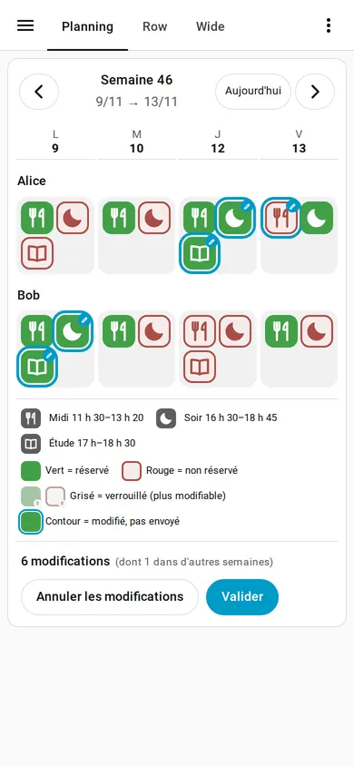
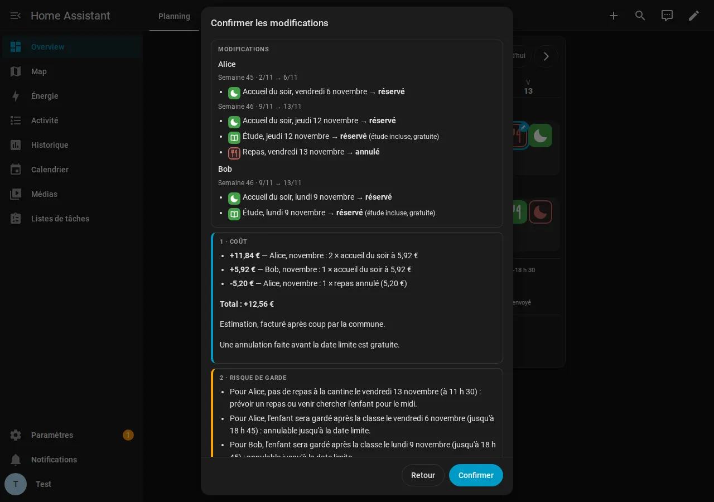

# Mon Espace Famille

 [English](#english) |  [Français](#français)

A Home Assistant integration for [Mon Espace Famille](https://app.monespacefamille.fr): the children's canteen, before- and after-school care and study hall in a calendar, and booking or cancelling them from Home Assistant.
Une intégration Home Assistant pour [Mon Espace Famille](https://app.monespacefamille.fr) : la cantine, l'accueil du matin et du soir et l'étude des enfants dans un calendrier, et leur réservation ou annulation depuis Home Assistant.

[](https://hacs.xyz/)
[](https://my.home-assistant.io/redirect/hacs_repository/?owner=Le-Syl21&repository=mon_espace_famille&category=integration)

<p align="center">
  
  
  
</p>
<p align="center"><sub>Une carte pour réserver et annuler : un tap prépare un brouillon, « Valider » demande confirmation avec le coût estimé.<br>One card to book and cancel: a tap prepares a draft, "Valider" asks for confirmation with the estimated cost.</sub></p>

<a name="français"></a>
##  Français

### Ce que ça donne

Vous ajoutez votre compte Mon Espace Famille (e-mail et mot de passe de l'application). Chaque enfant inscrit à au moins un service devient un appareil ; les enfants inscrits à rien (les grands au collège) sont ignorés. Pour une enfant nommée Alice :

| Entité | Quoi | Exemple |
|---|---|---|
| `calendar.alice_periscolaire` | Un événement par jour réservé et par service, aux heures du service ; la description donne la date limite d'annulation, et pour les jours passés, présent ou absent | Cantine 11 h 30 – 13 h 20, « Réservé. Annulable jusqu'au 12/11/2026 inclus. » |
| `binary_sensor.alice_cantine_aujourd_hui` | Allumé si un repas est réservé aujourd'hui ; attributs `statut`, `annulable_jusqu_au` | Allumé |
| `binary_sensor.alice_cantine_demain` | La même chose pour demain | Éteint |
| `binary_sensor.alice_reservation_manquante` | Allumé si la semaine prochaine a un jour où la cantine est ouverte sans repas réservé ; attribut `jours` | Allumé, `["2026-11-12"]` |
| `sensor.alice_prochain_repas` | Le prochain jour avec un repas réservé ; attribut `dans_jours` | 05/11/2026 |
| `sensor.alice_repas_cette_semaine` | Nombre de jours réservés cette semaine, un capteur par service (`accueil_matin`, `accueil_soir`, `etude`…) ; attributs `jours`, `aujourd_hui` et `demain` (réservé ou non, y compris le dimanche pour le lundi) | 4 |
| `binary_sensor.alice_accueil_du_soir_aujourd_hui` | Allumé si l'accueil du soir ou l'étude est réservé aujourd'hui ; attributs `service` (`accueil_soir` ou `etude`), `annulable_jusqu_au` | Allumé, `accueil_soir` |
| `sensor.alice_retour_prevu` | Heure de retour à la maison prévue aujourd'hui (horodatage) : fin du service du soir (18 h 45) + 10 min s'il y en a un, sinon fin de la classe (16 h 30) + 10 min ; inconnu si rien n'est réservé aujourd'hui ; attribut `service_du_soir` | 18:55 |
| `binary_sensor.alice_hors_de_la_maison` | Allumé du départ au retour prévu, les jours avec au moins une réservation : départ à 7 h si l'accueil du matin est réservé, sinon 8 h 10 ; bascule à l'heure dite, sans attendre la relecture ; attributs `depart`, `retour_prevu` | Éteint |

Les identifiants d'entités sont en français quelle que soit la langue de Home Assistant, pour pouvoir partager les automatisations ; les noms affichés sont traduits.

Horaires du calendrier : accueil du matin 7 h – 8 h 20, cantine 11 h 30 – 13 h 20, accueil du soir 16 h 30 – 18 h 45, étude 17 h – 18 h 30 (le périscolaire confie les enfants à l'école à 8 h 20 et 13 h 20). Un jour d'étude, `retour_prevu` reste la fin de l'accueil du soir (18 h 45), qui est réservé avec l'étude. Un service que l'intégration ne reconnaît pas devient un événement sur la journée.

Les données sont relues toutes les 30 minutes : la semaine en cours et les 3 suivantes (*Configurer* change ce nombre).

### Réserver et annuler

Deux actions, `mon_espace_famille.reserver` et `mon_espace_famille.annuler` :

```yaml
action: mon_espace_famille.reserver
data:
  enfant: calendar.alice_periscolaire   # une entité de l'enfant (ou son appareil)
  service: accueil_soir                 # repas, accueil_matin, accueil_soir ou etude
  dates:
    - "2026-11-12"                      # AAAA-MM-JJ ou JJ/MM/AAAA
    - "2026-11-16"
```

Le plus simple pour essayer : *Outils de développement* → *Actions*, choisissez l'action, l'enfant, le service et les dates. L'action répond avec la liste des dates réellement réservées (ou annulées).

Pour réserver d'un clic depuis le tableau de bord, faites un script avec un champ date, puis un bouton qui l'appelle :

```yaml
script:
  cantine_alice:
    alias: Réserver la cantine d'Alice
    fields:
      jour:
        name: Jour
        selector:
          date:
    sequence:
      - action: mon_espace_famille.reserver
        data:
          enfant: calendar.alice_periscolaire
          service: repas
          dates: ["{{ jour }}"]
```

`mon_espace_famille.annuler` prend les mêmes champs.

Avant d'envoyer quoi que ce soit, l'intégration relit les semaines concernées et refuse, avec un message clair :
- un service auquel l'enfant n'est pas inscrit ;
- une réservation un jour où le service est fermé (vacances, jour férié, mercredi) ou après la date limite de réservation ;
- une annulation d'un jour non réservé ou après la date limite d'annulation.

Les jours déjà réservés sont simplement sautés. Mon Espace Famille répond « en file d'attente » : l'intégration relit ensuite la semaine jusqu'à voir le changement (une dizaine de secondes au plus) et signale une erreur s'il n'apparaît pas.

Exemple : prévenir le dimanche soir s'il manque un repas.

```yaml
automation:
  - alias: Repas manquant la semaine prochaine
    triggers:
      - trigger: time
        at: "19:00:00"
    conditions:
      - condition: time
        weekday: sun
      - condition: state
        entity_id: binary_sensor.alice_reservation_manquante
        state: "on"
    actions:
      - action: notify.notify
        data:
          message: >
            Pas de cantine réservée pour Alice le
            {{ state_attr('binary_sensor.alice_reservation_manquante', 'jours') | join(', ') }}
```

### La carte « Planning » (0.2.0)

Une carte pour voir **et modifier** la semaine d'un coup d'œil : une ligne par enfant, une colonne par jour ouvert (les mercredis, week-ends et jours fériés disparaissent d'eux-mêmes), et dans chaque case une pastille par service auquel l'enfant est inscrit, dans l'ordre matin, midi, soir, étude.

| Pastille | Sens |
|---|---|
| Tuile verte | Réservé, modifiable |
| Tuile rouge | Non réservé, modifiable |
| Tuile grisée avec un petit cadenas | Verrouillé : jour passé, date limite d'annulation dépassée (réservé) ou de réservation dépassée (non réservé). Le survol ou la lecture d'écran donne la date limite. |
| Contour épais et crayon (la tuile montre la nouvelle couleur) | Modifié, pas encore envoyé |
| (vide) | Service non proposé ce jour-là |

Les flèches ← → changent de semaine (passé comme futur, lues sur le portail à la demande), « Aujourd'hui » revient à la semaine en cours, et l'en-tête donne le numéro de semaine et les dates (« Semaine 45 · 2/11 → 6/11 »).

**Modifier.** Toucher une pastille modifiable change un *brouillon* : rien n'est envoyé. Les cases modifiées sont mises en évidence et un pied de carte indique « n modification(s) » avec *Annuler les modifications* et *Valider*. Le brouillon survit au changement de semaine (on peut préparer plusieurs semaines puis valider d'un coup) ; il est perdu si l'on recharge la page.

**Valider.** *Valider* ouvre une fenêtre de confirmation qui liste les changements par enfant et par semaine, avec deux blocs distincts : **1 · Coût** (estimation de la différence de facture du mois, voir ci-dessous) et **2 · Risque de garde** (une phrase par changement, par exemple « Alice n'est plus prise en charge à partir de 16 h 30 le jeudi 12 novembre : il faut la récupérer à l'école »). *Confirmer* envoie les changements, un panier par enfant, puis relit le portail pour vérifier que chacun a bien été pris en compte.

**Étude et accueil du soir.** Le règlement de la commune veut que l'étude s'accompagne de l'accueil du soir : l'étude seule est refusée (par la carte, par les actions `reserver`/`annuler` et par l'intégration côté serveur). Dans la carte, cocher l'étude coche aussi le soir ; cocher le soir coche aussi l'étude seulement quand le portail la propose cet enfant ce jour-là (certaines semaines, ou certaines communes, n'ont pas d'étude ; on peut ensuite la décocher seule, elle est gratuite) ; décocher le soir retire l'étude.

**Coût.** La commune facture après coup et le portail n'annonce aucun montant ; la carte **estime** donc la différence de facture du mois à partir des tarifs que le portail publie : repas, accueil du matin et du soir à la journée jusqu'à 9 jours par mois, puis un forfait mensuel (accueil du matin 42,53 €, accueil du soir 55,59 €). Ces forfaits ne sont pas dans l'API : ce sont les valeurs par défaut d'Orgerus 2026-27, modifiables dans *Configurer* (voir *Tarifs et horaires*). Si les tarifs ne sont pas lisibles, la carte retombe sur le décompte des repas et accueils.

**Si le portail a bougé.** Juste avant d'envoyer, l'intégration relit le portail. Si l'une des cases touchées n'est plus dans l'état que vous voyiez (l'autre parent a réservé entre-temps), ou si un changement n'est plus possible (date limite dépassée, service non proposé), **rien n'est envoyé** : la carte vous montre ce qui a changé et vous laisse revoir. Si seule une partie des changements est confirmée par le portail, la carte liste ceux qui n'ont pas abouti.

<p align="center"> </p>

#### Ajouter la carte

En mode « stockage », l'intégration ajoute aussi la carte comme **ressource Lovelace** (module, sans doublon, à jour quand le fichier change, retirée avec le compte) : c'est ce qui fiabilise l'affichage dans l'application mobile sur un réseau lent, où un module chargé autrement peut arriver après le tableau de bord (« Custom element doesn't exist »). Elle reste aussi chargée comme module supplémentaire, ce qui suffit en mode YAML. Dans l'éditeur du tableau de bord, *Ajouter une carte* → *Personnalisé : Mon Espace Famille*, ou en YAML :

```yaml
type: custom:mon-espace-famille-planning-card
layout: grid          # grid (2 × 2, défaut) ou row (sur une ligne, carte large)
# entry_id: ...       # seulement si vous avez plusieurs comptes
# children: [Alice]   # n'afficher que ces enfants (prénoms ou identifiants)
# title: Périscolaire
```

| Option | Rôle |
|---|---|
| `layout` | `grid` : les pastilles en 2 × 2, étroit, tient sur téléphone. `row` : les pastilles d'un jour sur une ligne, pour une carte large (tableau de bord en pleine largeur) ; là où la carte est trop étroite (téléphone), elle repasse seule en 2 × 2 |
| `entry_id` | Le compte, si vous en avez plusieurs (sinon le premier) |
| `children` | Liste de prénoms ou d'identifiants à afficher |
| `title` | Un titre au-dessus de la carte |

Si votre tableau de bord est en mode YAML et que la carte n'apparaît pas, ajoutez la ressource à la main : `url: /mon_espace_famille/mon-espace-famille-planning-card.js`, `type: module`.

#### Commandes WebSocket

Pour les curieux (la carte les utilise ; tout utilisateur connecté peut les appeler, pas besoin d'être administrateur) : `mon_espace_famille/planning` (`start` : une date de la semaine voulue), `mon_espace_famille/quote` (`changes` : liste de `{child, service, date, action: book|cancel}`) et `mon_espace_famille/apply` (`changes` et `base`, l'état de chaque case tel que la carte le voyait). Les actions `reserver` et `annuler` ci-dessus continuent de fonctionner.

### Tarifs et horaires (réglages)

*Paramètres* → *Appareils et services* → *Mon Espace Famille* → *Configurer* ouvre trois pages : les semaines lues, puis **Tarifs**, puis **Horaires**. Rien n'est enregistré avant la dernière page ; l'intégration se recharge ensuite.

| Réglage | Défaut (Orgerus 2026-27) |
|---|---|
| Jours à partir desquels le forfait mensuel s'applique (0 = jamais) | 9 |
| Forfait mensuel, accueil du matin / du soir (vide ou 0 = aucun) | 42,53 € / 55,59 € |
| Prix à la journée du repas, du matin, du soir, de l'étude | vide = **le prix du portail**, qui suit déjà le profil de chaque enfant ; ne le remplissez que pour le remplacer |
| Début et fin du matin, de la cantine, du soir, de l'étude | 7 h – 8 h 20, 11 h 30 – 13 h 20, 16 h 30 – 18 h 45, 17 h – 18 h 30 |

Les horaires alimentent le calendrier, la légende et les phrases de la carte, et les capteurs de présence (la fin de classe est le début de l'accueil du soir, le retour prévu suit la fin de l'accueil du soir, le départ suit le début de l'accueil du matin). Les heures doivent être au format HH:MM, la fin après le début, les prix positifs. Si un prix ou un forfait diffère des valeurs d'Orgerus, l'estimation de la carte ajoute « (tarifs personnalisés) ».

### Chauffer la chambre au bon moment

Le capteur `retour_prevu` permet de garder une chambre froide tant que l'enfant est à l'accueil du soir, et de ne la chauffer qu'une heure avant son retour (les 10 minutes de trajet sont déjà comptées) :

```yaml
automation:
  - alias: Préchauffer la chambre d'Alice
    triggers:
      - trigger: time_pattern
        minutes: "/5"
    conditions:
      - condition: template
        value_template: >
          
          {{ retour not in ('unknown', 'unavailable')
             and as_timestamp(now()) >= as_timestamp(retour) - 3600
             and as_timestamp(now()) < as_timestamp(retour) }}
    actions:
      - action: climate.set_temperature
        target:
          entity_id: climate.chambre_alice
        data:
          temperature: 19
```

Les jours sans réservation, `retour_prevu` est inconnu : la condition est fausse et cette automatisation ne fait rien, à vous de prévoir le chauffage habituel (mercredi, vacances) avec une autre automatisation.

### Installation

1. Dans HACS, *Dépôts personnalisés* → ajoutez `https://github.com/Le-Syl21/mon_espace_famille`, catégorie *Intégration* ([ou ouvrez-la directement dans votre HACS](https://my.home-assistant.io/redirect/hacs_repository/?owner=Le-Syl21&repository=mon_espace_famille&category=integration)).
2. Installez-la, redémarrez Home Assistant.
3. *Paramètres* → *Appareils et services* → *Ajouter une intégration* → *Mon Espace Famille*.
4. Saisissez l'e-mail et le mot de passe de l'application. Si le mot de passe change, Home Assistant demande de se reconnecter.

### Limites

- Réserver et annuler des jours, oui ; **inscrire** un enfant à un service pour l'année (par exemple l'accueil du matin qu'on n'avait pas coché en début d'année), non : le portail traite cela comme une demande que la mairie valide, à faire sur le portail.
- Mon Espace Famille ne publie pas d'API : l'intégration parle à celle de son application web, qui peut changer sans prévenir.
- Testée avec une seule commune, où les services sont payés après coup. Une commune en prépaiement, où il faut payer pour valider le panier, n'est pas prise en charge. La carte annonce donc des quantités et non un prix : le portail ne donne pas de montant à l'avance pour une commune à paiement différé (le montant n'est lu que s'il en annonce un, ce qui n'a pas pu être vérifié).
- La carte déduit les jours d'école de ce que le portail propose : un jour férié ou un mercredi n'apparaît pas, mais un jour déjà verrouillé et jamais proposé avant ne peut pas toujours être distingué d'un jour fermé.
- Les horaires se règlent dans *Configurer* (défauts d'Orgerus) et sont les mêmes tous les jours ; le départ à 8 h 10 sans accueil du matin et la marge de trajet de 10 min restent dans `const.py`.

### 💬 Communauté & support

Des questions, un bug à signaler ou juste envie d'en discuter ? Rejoignez le Discord, section *Home Assistant*, salon [#mon-espace-famille](https://discord.com/channels/1529873522652872744/1566916065991331943) (utile pour dire si votre commune fonctionne) :

[](https://discord.gg/T37DYHmt2j)

<a name="english"></a>
##  English

### What you get

You add your Mon Espace Famille account (the app's email and password). Each child registered to at least one service becomes a device; children registered to nothing (older ones in secondary school) are left out. For a child named Alice:

| Entity | What | Example |
|---|---|---|
| `calendar.alice_periscolaire` | One event per booked day and service, at the service's hours; the description gives the cancellation deadline and, for past days, whether the child attended | Cantine 11:30–13:20, "Réservé. Annulable jusqu'au 12/11/2026 inclus." |
| `binary_sensor.alice_cantine_aujourd_hui` | On when a meal is booked today; `statut`, `annulable_jusqu_au` attributes | On |
| `binary_sensor.alice_cantine_demain` | The same for tomorrow | Off |
| `binary_sensor.alice_reservation_manquante` | On when next week has a day the canteen is open with no meal booked; `jours` attribute | On, `["2026-11-12"]` |
| `sensor.alice_prochain_repas` | The next day with a meal booked; `dans_jours` attribute | 2026-11-05 |
| `sensor.alice_repas_cette_semaine` | Days booked this week, one sensor per service (`accueil_matin`, `accueil_soir`, `etude`…); attributes `jours`, `aujourd_hui` and `demain` (booked or not, Sunday's tomorrow being Monday included) | 4 |
| `binary_sensor.alice_accueil_du_soir_aujourd_hui` | On when evening care or study hall is booked today; `service` (`accueil_soir` or `etude`) and `annulable_jusqu_au` attributes | On, `accueil_soir` |
| `sensor.alice_retour_prevu` | Expected arrival home today (timestamp): end of the evening service (18:45) + 10 min when there is one, else end of school (16:30) + 10 min; unknown when nothing is booked today; `service_du_soir` attribute | 18:55 |
| `binary_sensor.alice_hors_de_la_maison` | On from departure to the expected return, on days with at least one booking: departure at 7:00 when morning care is booked, else 8:10; flips on time without waiting for a refresh; `depart` and `retour_prevu` attributes | Off |

Entity ids are French and the same in every language, so automations can be shared; the displayed names are translated.

Calendar hours: morning care 7:00–8:20, canteen 11:30–13:20, evening care 16:30–18:45, study hall 17:00–18:30 (the after-school service hands children to the school at 8:20 and 13:20). On a study day `retour_prevu` stays the end of the evening care (18:45), which is booked with the study hall. A service the integration does not recognise becomes an all-day event.

The data is read every 30 minutes: the current week and the next 3 (*Configure* changes that number).

### Booking and cancelling

Two actions, `mon_espace_famille.reserver` (book) and `mon_espace_famille.annuler` (cancel), with the fields `enfant` (the child's device, or one of its entities), `service` (`repas`, `accueil_matin`, `accueil_soir` or `etude`) and `dates` (`YYYY-MM-DD` or `DD/MM/YYYY`):

```yaml
action: mon_espace_famille.reserver
data:
  enfant: calendar.alice_periscolaire   # an entity of the child (or its device)
  service: accueil_soir                 # repas, accueil_matin, accueil_soir or etude
  dates:
    - "2026-11-12"
    - "2026-11-16"
```

The easiest way to try it: *Developer tools* → *Actions*, pick the action, the child, the service and the dates. The action answers with the list of dates actually booked (or cancelled).

To book with one tap from a dashboard, make a script with a date field, then a button that calls it:

```yaml
script:
  alice_canteen:
    alias: Book Alice's canteen
    fields:
      jour:
        name: Day
        selector:
          date:
    sequence:
      - action: mon_espace_famille.reserver
        data:
          enfant: calendar.alice_periscolaire
          service: repas
          dates: ["{{ jour }}"]
```

`mon_espace_famille.annuler` takes the same fields.

Before sending anything the integration reads the weeks concerned again and refuses, with a clear message, a service the child is not registered to, a booking on a day the service is closed or past its booking deadline, and a cancellation of a day not booked or past its cancellation deadline. Days already booked are skipped. Mon Espace Famille answers "queued": the integration then reads the week again until the change shows (ten seconds at most) and raises an error if it does not.

### The "Planning" card (0.2.0)

A card to see **and edit** the week at a glance: a row per child, a column per open day (Wednesdays, weekends and holidays disappear by themselves), and in each cell one pastille per service the child is registered to, in the order morning, noon, evening, study.

| Pastille | Meaning |
|---|---|
| Green tile | Booked, editable |
| Red tile | Not booked, editable |
| Greyed tile with a small padlock | Locked: past day, cancellation deadline passed (booked) or booking deadline passed (not booked). Hovering or a screen reader gives the deadline. |
| Thick outline and pencil | Changed, not sent yet |
| (empty) | Service not offered that day |

The ← → arrows change week (past and future, read from the portal on demand), "Today" goes back to the current week, and the header gives the week number and dates ("Week 45 · 2/11 → 6/11").

**Editing.** Tapping an editable pastille changes a *draft*: nothing is sent. Changed cells are highlighted and a footer shows "n change(s)" with *Undo changes* and *Validate*. The draft survives week navigation (prepare several weeks, validate once); it is lost when the page reloads.

**Validating.** *Validate* opens a confirmation dialog listing the changes per child and per week, with two separate blocks: **1 · Cost** (the portal is asked read-only; a deferred-payment commune such as Orgerus announces no amount, so the card shows the number of meals and cares concerned, "billed afterwards") and **2 · Childcare risk** (one sentence per change, for example "Alice is no longer looked after from 16:30 on Thursday 12 November: pick her up at school"). *Confirm* sends the changes, one cart per child, then reads the portal again to check each one was taken into account.

**Study hall and evening care.** The commune's rules require the evening care with the study hall: a study hall alone is refused (by the card, by the `reserver`/`annuler` actions and by the integration on the server). In the card, ticking the study hall also ticks the evening care; ticking the evening care also ticks the study hall only when the portal offers it to that child that day (some weeks, or some communes, have none; you can then untick it alone, it is free); unticking the evening care removes the study hall.

**Cost.** The commune bills afterwards and the portal announces no amount, so the card **estimates** the month's bill difference from the rates the portal publishes: meals, morning and evening care per day up to 9 days a month, then a monthly flat fee (morning 42.53 €, evening 55.59 €). Those flat fees are not in the API: they are the Orgerus 2026-27 defaults, editable in *Configure* (see *Prices and hours*). If the rates cannot be read the card falls back to counting meals and cares.

**When the portal moved.** Right before sending, the integration reads the portal again. If one of the touched cells is no longer in the state you saw (the other parent booked meanwhile), or a change is no longer possible (deadline passed, service not offered), **nothing is sent**: the card shows what changed and lets you review. If the portal confirms only part of the changes, the card lists those that did not go through.

<p align="center"> </p>

#### Adding the card

In storage mode the integration also adds the card as a **Lovelace resource** (module, never duplicated, updated when the file changes, removed with the account): that is what makes it reliable in the mobile app on a slow network, where a module loaded another way can arrive after the dashboard ("Custom element doesn't exist"). It stays loaded as an extra module too, which is enough in YAML mode. In the dashboard editor, *Add card* → *Custom: Mon Espace Famille*, or in YAML:

```yaml
type: custom:mon-espace-famille-planning-card
layout: grid          # grid (2 × 2, default) or row (one line, wide card)
# entry_id: ...       # only if you have several accounts
# children: [Alice]   # show only these children (first names or ids)
# title: After-school
```

| Option | Purpose |
|---|---|
| `layout` | `grid`: pastilles 2 × 2, narrow, fits a phone. `row`: a day's pastilles on one line, for a wide card (full-width dashboard); where the card is too narrow (a phone) it falls back to 2 × 2 by itself |
| `entry_id` | The account, if you have several (else the first one) |
| `children` | List of first names or ids to show |
| `title` | A title above the card |

If your dashboard is in YAML mode and the card does not show up, add the resource by hand: `url: /mon_espace_famille/mon-espace-famille-planning-card.js`, `type: module`.

#### WebSocket commands

For the curious (the card uses them; any logged-in user can call them, no need to be an administrator): `mon_espace_famille/planning` (`start`: a date of the wanted week), `mon_espace_famille/quote` (`changes`: a list of `{child, service, date, action: book|cancel}`) and `mon_espace_famille/apply` (`changes` and `base`, each cell's state as the card saw it). The `reserver` and `annuler` actions above keep working.

### Prices and hours (settings)

*Settings* → *Devices & services* → *Mon Espace Famille* → *Configure* opens three pages: the weeks read, then **Prices**, then **Hours**. Nothing is saved before the last page; the integration then reloads.

| Setting | Default (Orgerus 2026-27) |
|---|---|
| Days after which the monthly flat fee applies (0 = never) | 9 |
| Monthly flat fee, morning / evening care (empty or 0 = none) | €42.53 / €55.59 |
| Per-day price of the canteen, morning, evening, study | empty = **the portal's price**, which already follows each child's profile; fill it only to override |
| Start and end of morning care, canteen, evening care, study | 7:00–8:20, 11:30–13:20, 16:30–18:45, 17:00–18:30 |

The hours feed the calendar, the card's legend and sentences, and the presence sensors (school ends when the evening care starts, the expected return follows the evening care's end, the departure follows the morning care's start). Times must be HH:MM, the end after the start, prices not negative. When a price or fee differs from Orgerus's, the card's estimate adds "(custom prices)".

### Heating a bedroom at the right time

The `retour_prevu` sensor lets a bedroom stay cold while the child is in evening care, and be heated only an hour before the child gets home (the 10 minutes of travel are already counted):

```yaml
automation:
  - alias: Preheat Alice's bedroom
    triggers:
      - trigger: time_pattern
        minutes: "/5"
    conditions:
      - condition: template
        value_template: >
          
          {{ retour not in ('unknown', 'unavailable')
             and as_timestamp(now()) >= as_timestamp(retour) - 3600
             and as_timestamp(now()) < as_timestamp(retour) }}
    actions:
      - action: climate.set_temperature
        target:
          entity_id: climate.alice_bedroom
        data:
          temperature: 19
```

On days with no booking `retour_prevu` is unknown, the condition is false and this automation does nothing: cover those days (Wednesday, holidays) with your usual heating schedule.

### Installation

1. In HACS, *Custom repositories* → add `https://github.com/Le-Syl21/mon_espace_famille`, category *Integration* ([or open it straight in your HACS](https://my.home-assistant.io/redirect/hacs_repository/?owner=Le-Syl21&repository=mon_espace_famille&category=integration)).
2. Install it, restart Home Assistant.
3. *Settings* → *Devices & services* → *Add integration* → *Mon Espace Famille*.
4. Enter the app's email and password. If the password changes, Home Assistant asks you to log in again.

### Limits

- Booking and cancelling days works; **registering** a child to a service for the year (for instance the morning care that was not ticked at the start of the year) does not: the portal handles it as a request that the town hall validates, so do it on the portal.
- Mon Espace Famille publishes no API: the integration talks to its web app's one, which may change without notice.
- Tested with a single commune, where services are paid afterwards. A commune where the cart must be paid in advance is not supported. The card therefore announces quantities, not a price: the portal gives no amount in advance for a deferred-payment commune (an amount is only read if the portal announces one, which could not be verified).
- The card infers school days from what the portal offers: a holiday or a Wednesday does not show, but a day that is already locked and was never offered before cannot always be told apart from a closed day.
- The hours (calendar, 8:10 or 7:00 departure, end of school, 10-minute travel margin) are set in *Configure* (Orgerus defaults) and are the same every day; the 8:10 departure without morning care and the 10-minute travel margin stay in `const.py`.

### 💬 Community & support

Questions, bug reports, or just want to chat? Join the Discord, *Home Assistant* section, channel [#mon-espace-famille](https://discord.com/channels/1529873522652872744/1566916065991331943) (a good place to say whether your commune works):

[](https://discord.gg/T37DYHmt2j)

## Development / Développement

```sh
python3.14 -m venv .venv
.venv/bin/pip install -r requirements_test.txt
.venv/bin/pytest
```

The tests never reach the real server: a fake one answers from anonymised recordings in `tests/fixtures`.

The card is also driven in a real browser: `tests/browser/run.sh` starts Home Assistant and a stand-in portal (`tests/browser/fake_portal.py`, reached through the developer-only `MEF_API_BASE` environment variable) in Docker and clicks through the card with Playwright (screenshots, and the exact carts the portal receives).

## License / Licence

MIT. See [LICENSE](LICENSE).
